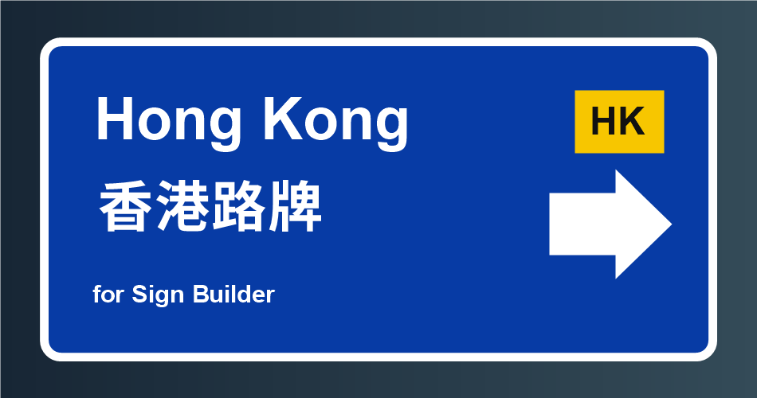

# Hong Kong Road Signs

Hong Kong Road Signs is created by K1234.

This is a separate add-on for [Sign Builder](https://mods.paradoxplaza.com/mods/165726/Windows). Install and enable Sign Builder first, then enable this add-on.

Version 1.1.2 is built for the Sign Builder main source from 12 November 2026, which includes symbol libraries for all themes. This is a local compatibility build until the author publishes that feature set.

## Features

- Create bilingual English and Chinese road signs with Hong Kong fonts, colours, route shields, and symbols.
- Build rounded, pointed flag, and stacked signs using editable chips, arrows, exit plaques, and dividers.
- Add roundabout and fork diagrams, JTIS minutes displays, and LED messages.
- Start from Hong Kong templates, then edit each sign part in the Sign Builder workflow.

## Installation

- `SignBuilder`: the author's original mod (required; Paradox Mods ID 165726).
- `HKSignBuilderAddon`: Hong Kong theme, symbols, templates, editor, and renderer.

The add-on uses Sign Builder's placement and save system. The original Sign Builder toolbar button opens the Hong Kong capable editor while the add-on is active. If the add-on cannot initialize its renderer or UI, the original editor remains available. Existing signs remain in the normal Sign Builder save format.

Its own content is in the `HKSignBuilderAddon` folder. Do not include a second copy of Sign Builder when publishing this add-on. The add-on checks the Sign Builder APIs it needs at startup and stays inactive if a future Sign Builder update changes them. Such an update may require a new add-on release.

For a local installation, copy the packaged `HKSignBuilderAddon` folder into the game's `Mods` folder alongside Sign Builder. For Paradox Mods, publish only the HK add-on content directory using this project's `Properties/PublishConfiguration.xml`. The thumbnail for the listing is `Properties/Thumbnail.png` and the dependency is Sign Builder (ID 165726).

The theme uses fonts, symbols, and artwork covered by the licenses and source details in `THIRD-PARTY-NOTICES.md` and `SignBuilderThemes/hk/SOURCES.txt`.
